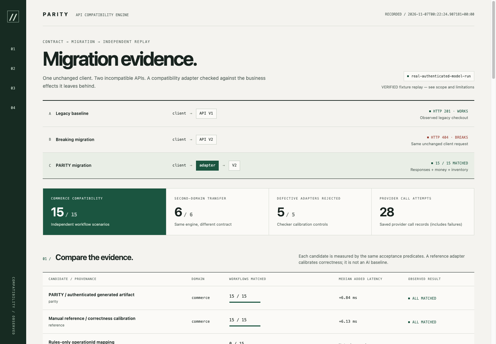

# PARITY

API migration adapters with independent response and business-state validation.

PARITY compares OpenAPI contracts, uses a real model to write a versioned migration plan and Python adapter, executes that adapter in a restricted worker, and independently compares client responses **and business effects**.

The flagship example is checkout. V1 commits one atomic operation. V2 requires a draft, stock reservation, simulated payment and confirmation. The adapter keeps durable checkpoints and integer↔UUID mappings, recovers after lost responses and restarts, and compensates rejected orders without inventing success.

This repository contains real authenticated generation evidence, including an observed error-precedence mismatch and a model-authored repair. The default demo replays pinned artifacts **offline**; it does not pretend to generate them live.



## Run it

Release primary environment: Python 3.12 on macOS with `sandbox-exec`. Linux/bubblewrap and other Python versions are compatibility targets, not certified by this release pass. Run from this repository root. Windows untrusted execution is not supported.

The [release checklist](docs/RELEASE_CHECKLIST.md) covers clean installation, replay and packaging. Historical provider outputs and release fingerprints are retained under `artifacts/`. Rebuild the public archive with `scripts/package_release.py` before distribution.

```bash
make setup
make test
make check
make demo
```

`make demo` starts isolated real HTTP services, runs the unchanged legacy client, checks the generated adapters and reference implementation, tests defective adapters, and writes a self-contained HTML report. It uses no model credentials, internet or LLM tokens after dependencies are installed.

The checked-in evidence report is [artifacts/reports/clean-demo/index.html](artifacts/reports/clean-demo/index.html). Open it directly in a browser. New report paths are printed by the CLI and recorded in `artifacts/reports/LATEST`.

```text
Legacy client → V1: HTTP 201; unchanged client → V2: HTTP 404
PARITY: draft → reserve → capture → confirm
Lost payment response: 503 PENDING → worker restart → same-key retry
Independent checks: order count, ledger amount/count, stock, visibility, errors
```

The final commerce suite has 15 workflows; the transfer suite has 6. Exact observed scores, timings and hashes are stored in JSON next to the HTML report. A deliberately fake adapter that returns plausible success without creating an order is rejected by the business-state checker.

## Make a fresh AI migration

The exercised provider is the authenticated Codex CLI. Install it separately, run `codex login`, then:

```bash
make demo-live
# Equivalent, with explicit paths:
.venv/bin/parity generate --old contracts/commerce/v1.json \
  --new contracts/commerce/v2.json --provider codex --out artifacts/generated/my-run
.venv/bin/parity validate --adapter artifacts/generated/my-run --suite commerce
```

`--out` must be a new directory. Model calls consume the configured account's quota. Authentication/quota/transport failure stops the trial and preserves its evidence. A subscription is not treated as an API key.

The optional Responses API provider requires `OPENAI_API_KEY` and an explicitly accessible `--model`; that provider was implemented but not live-tested here:

```bash
.venv/bin/parity generate --old contracts/commerce/v1.json \
  --new contracts/commerce/v2.json --provider openai --model "$PARITY_MODEL"
```

Use the same generic engine for the smaller issue-tracker migration:

```bash
.venv/bin/parity generate --old contracts/transfer/v1.json \
  --new contracts/transfer/v2.json --provider codex
.venv/bin/parity validate --adapter transfer-live-001 --suite transfer
```

The transfer translates atomic ticket creation into draft issue → initial comment → publication. It is a separate application domain, not another commerce route.

## Inspect and reproduce

```bash
.venv/bin/parity inspect --old contracts/commerce/v1.json --new contracts/commerce/v2.json
.venv/bin/parity validate --adapter commerce-live-002 --suite commerce
.venv/bin/parity demo --artifact commerce-live-002
# Optional real PostgreSQL integration using disposable local server tools:
.venv/bin/python scripts/check_postgres.py
```

For manual API exploration, run two terminals:

```bash
.venv/bin/parity serve --version old --db .parity/manual-v1.db --port 8001
.venv/bin/parity serve --version new --db .parity/manual-v2.db --port 8002
```

Open `/docs` on each port. Services seed only a new database; existing data survives. Use new database paths for an isolated reset. Docker Compose supplies isolated PostgreSQL service databases but was **not executed** because the Docker daemon and Compose CLI plugin were unavailable. Local PostgreSQL 18.3 was exercised separately, including restart.

## Where the evidence lives

| Artifact | Meaning |
|---|---|
| `artifacts/generated/commerce-live-001/` | First real generated plan/source; public success followed by provider quota failure; later precedence mismatch preserved |
| `artifacts/generated/commerce-live-002/` | Real continuation: failed public trial, revised plan/source, passing public trial |
| `artifacts/generated/transfer-live-001/` | Real generated second-domain adapter |
| `artifacts/generated/commerce-single-shot-001/` | Real single-shot output rejected by strict plan validation; not executed |
| `artifacts/reference/` | Manually authored calibration adapters; never provided to the migration agent |
| `artifacts/pins.json` | Exact client, evaluator, plan and adapter hashes |
| `artifacts/reports/clean-demo/` | Reproducible scores, per-scenario before/after state, traces and actual mismatches |
| `artifacts/reports/postgres-verification.json` | PostgreSQL workflow/restart evidence |

Model prompts, raw JSONL responses, tool arguments/results, usage and timing are retained. The CLI default model's precise server identity and dollar cost were not disclosed; they are recorded as unknown rather than guessed. One small comparison does not demonstrate statistical superiority.

The approval-receipt fixture has a recorded generation attempt and 4/4 passing private cases in `artifacts/releases/hardening/challenge-private/`. This is curated local evidence, not arbitrary-API generalization. Public release copies redact machine paths and provider identifiers with a redaction ledger; the original transcripts remain local. Missing usage counters are recorded as unobserved.

## Boundaries

Supported: local REST/JSON fixtures, integer minor currency, single adapter host, bounded listings, durable retry recovery, refundable simulated payment, cancellation and explicit pending results. V1's **temporal atomic visibility** cannot be preserved while a multi-transaction V2 saga is pending. Retry drives reconciliation; there is no autonomous background sweeper.

Unsupported: real payment gateways, shipping, auth migration, arbitrary APIs without fixture registration, streaming, multi-currency, external writers, multi-host adapter replicas and irreversible effects. Listings exceeding the generated artifact's explicit budget return a defined failure. SQLite local locking is not represented as equivalent to PostgreSQL concurrency.

See [architecture](docs/ARCHITECTURE.md), [contract semantics](docs/CONTRACT_AND_SEMANTICS.md), [evaluation](docs/EVALUATION.md), [security limits](docs/SECURITY_AND_LIMITATIONS.md), and the [demo script](docs/DEMO_SCRIPT.md).
