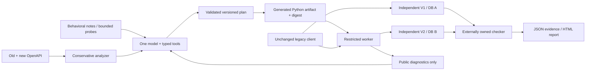

# Architecture

PARITY's path is **contracts → evidence → plan → generated code → actual HTTP execution → independent replay**. The model chooses semantic mappings and writes orchestration. Deterministic software owns transactions, resource limits, acceptance and evidence.

## Components

`contracts.py` parses OpenAPI 3.x JSON, resolves local references, identifies removed/changed operations, request/response/parameter differences, schema fields and pagination concerns. Every delta has source pointers. Operation IDs suggest candidates; they do not establish behavioral equivalence. Schemas cannot prove atomicity, conservation or idempotency.

`plans.py` defines the domain-neutral typed IR. A plan names concrete old/new HTTP operations, field transformations, ordered steps, retries, compensation, error mappings, evidence, ID policy and limitations. Validation rejects unknown operations and cyclic/out-of-order dependencies. Python remains the implementation language; this IR is not a giant workflow interpreter.

`agent.py` owns one bounded model loop. Typed tools inspect contracts/docs, issue at most six loopback probes, submit a plan, submit at most three code attempts, run public tests, inspect failures and finish. Plans must precede source; public checks must pass before finish. State is saved after actions. Provider unavailability stops the run. `resume` supplies only the model's own earlier source/plan and public diagnostics.

`providers.py` supplies an exercised Codex CLI provider and an optional Responses provider. CLI native execution/apps/browser features are disabled; allowed actions return as structured JSON and are validated by the engine. The CLI process retains its own authentication; generated code receives none.

`runtime.py` provides a small capability surface: bounded upstream HTTP, durable JSON checkpoints, stable integer↔UUID correspondence and a local OS lock. It contains no checkout or ticketing mapping. `worker.py` exposes the plugin's V1-facing HTTP responses. Generated modules are stored outside engine libraries and can be replayed without model access.

`replay.py` and `transfer_replay.py` own independent acceptance predicates. Generated workers cannot read them. Public diagnostics are a different module and never return private checker code. The evaluator records hashes and snapshots and rejects meaningful mutants. The same predicates apply to rules, reference and generated commerce candidates.

## State and boundaries

Each business API owns its own SQL database. The document store has a physical `records(bucket,key,payload)` table with a composite primary key; logical collections are inventory, orders, reservations, payment ledger, request keys and counters. Adapter storage separately holds workflow fingerprints, stages, upstream references and ID mappings.

V1 is implemented independently in one SQL transaction. V2's primitives each own a separate transaction. SQLite uses `BEGIN IMMEDIATE`; PostgreSQL uses a transaction-scoped advisory lock. Deliberate write serialization makes the small fixture auditable, at the cost of throughput. It is not a production database architecture recommendation.

The adapter checkpoints between network calls. Its transaction cannot span V2. A lost acknowledged payment is reconciled by repeating the same upstream key and body, relying on V2's durable per-key AND per-order payment identity. OS file locks serialize adapter workers on one host; they are not distributed locks.

Generated code executes in a copied runtime bundle. The evaluator, manual reference, repository and credentials are outside its permitted read roots. Only the controlled V2 loopback port is reachable under the exercised macOS policy. The evaluator remains in the trusted parent and reads business databases directly. See the security guide for residual limits.

## Acceptance mechanisms

The fixed legacy client works on V1, fails on direct V2, and recovers through a generated adapter. Tests inspect HTTP semantics and final effects: no missing/extra orders, exact charge/refund counts and amounts, stock conservation, cancellation visibility and stable IDs. Faults can occur before or after committed V2 steps. Fault injection is harness-owned in memory, not a public administration endpoint.

A second issue-tracker fixture uses the same analyzer, plan validator, providers, agent tools, runtime and sandbox. Only fixture construction and domain-owned acceptance checks are registered. This demonstrates transfer across two chosen domains; it does not establish automatic support for arbitrary APIs.
